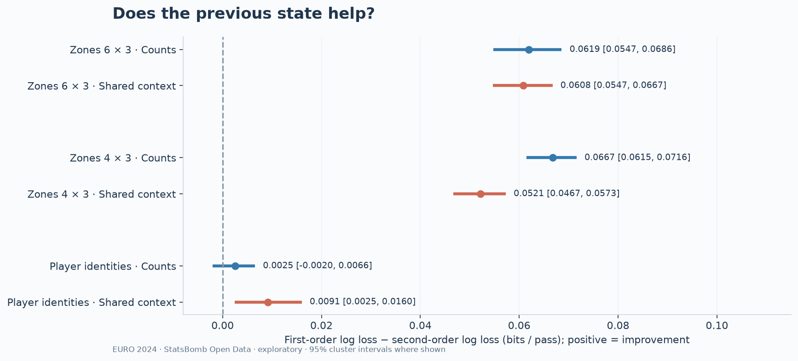
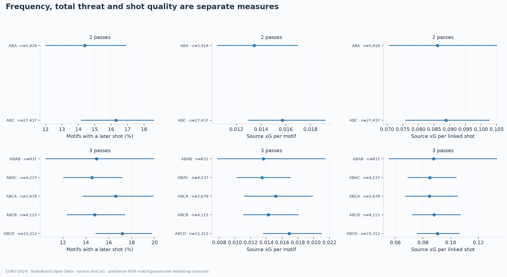

# Memory-Aware Football Passing Networks

**Does knowing who passed to a player help explain the next pass and the attacking continuation?**

An exploratory, reproducible study of **all 51 EURO 2024 matches**, using StatsBomb event data, Python, pandas, NetworkX and scikit-learn. It connects ordinary passing networks with real event sequences, first-/second-order prediction, downstream player metrics and two-/three-pass motifs.

**Data: [StatsBomb Open Data](https://github.com/hudl/open-data)**, pinned to commit `4b73468fc5b0f1950f9f66fada70ad3a4f9327cb`. This project is independent of StatsBomb and Hudl. [Data terms and attribution](THIRD_PARTY_NOTICES.md).

## Start here

- **[Research notebook source](notebooks/memory_aware_analysis.ipynb)** — the research question, principal comparisons, figures and interpretation.
- **[Methods and results](docs/STUDY_GUIDE.md)** — definitions, study design and limitations.
- **[Reproduction guide](docs/REPRODUCIBILITY.md)** — setup, pipeline order, checks and computation notes.
- **[Public aggregate gallery](results/public/index.html)** — twelve aggregate analytical figures. Detailed reports and tables are regenerated locally; public notebooks contain source only.

**Public publication profile:** original code, English methods, four source-only notebooks and **12 aggregate PNG/SVG figure pairs**. Raw/normalized events, detailed sequences, CSV tables, saved predictions, trained xT grids and all notebook outputs are excluded. This is non-commercial research; the MIT code license does not permit redistribution or commercial exploitation of StatsBomb data/analysis. [Publication policy](docs/PUBLICATION_POLICY.md).

## Main findings

### Spatial history helps predict the next pass

On **33,358 observed successful A → B → C paths**, compare first order `P(C | B)` with second order `P(C | A, B)`. Models use the same held-out observations, with both teams of a match kept in the same fold.

| Representation | Second-order gain, bits/pass [95% CI] | Gain with common receipt context [95% CI] |
|---|---:|---:|
| Pitch zones, 6 × 3 | 0.06193 [0.05473, 0.06858] | 0.06079 [0.05466, 0.06673] |
| Pitch zones, 4 × 3 | 0.06674 [0.06151, 0.07160] | 0.05213 [0.04669, 0.05727] |
| Within-team player IDs | 0.00253 [−0.00200, 0.00656] | 0.00915 [0.00249, 0.01601] |

Positive gain means lower held-out log loss. Spatial memory helps beyond shared receipt context. **Player-identity memory is smaller and baseline-sensitive**: the simple count comparison includes zero; identity context models have worse absolute loss than count baselines. Rolling evaluation has less prior history and fixed smoothing, and does not reproduce the retrospective second-order benefit.

### More shots and better shots are different questions

Completed-motif outcomes begin **after the final receipt**. The source-xG extension follows the remainder of the same provider possession, stopping earlier at confirmed opponent control, a goal or observed period end.

| Three-pass motif | Observed motifs | Later shot | Source xG/motif | Source xG/linked shot |
|---|---:|---:|---:|---:|
| ABAB: two players alternating | 831 | 14.92% | 0.01362 | 0.08776 |
| ABCD: four distinct players | 15,312 | 17.18% | 0.01690 | 0.09039 |

The ABCD−ABAB xG/motif difference is **+0.00328 [95% CI −0.00391, +0.00931]**. Point estimates suggest more subsequent shots rather than a large difference in average quality, but **do not establish a reliable advantage or a causal effect**. All motifs, a 10-second horizon, timing filters and unique-shot sensitivity are included.

### Downstream player estimates remain uncertain

The continuation analysis retains **41,927 completed initial open-play passes**, including later failures by B. R3 uses the first shot's source xG within three later ball actions, confirmed loss as zero, or training-only xT at a retained endpoint. **R3 is an exploratory mixed proxy, distinct from the pure source-xG measures above.**

There are 39,528 known R3 outcomes (94.28%). Supported estimates cover **127 players, 242 pairs and 30 triples**, with coverage and uncertainty. No supported player's positive primary R3 excess has a pointwise interval entirely above zero. These are exploratory comparisons rather than a definitive playmaker ranking. A backward pass is not automatically penalised, and B's later error is not automatically attributed to A.

## Analysis map

| Component | Scope | Methods and results |
|---|---|---|
| Event sequences | 187,864 events; 53,888 attempts; 13 typed tables; real paths, failures, pressure, zones and roles | [Definitions](docs/EURO_SEQUENCES.md) · report (`results/euro_sequences/report.html`, generated locally) |
| Memory prediction | 45 nested outer experiments; common candidates; held-out probabilities | [Methods](docs/MEMORY_EVALUATION.md) · report (`results/memory/report.html`, generated locally) |
| Continuation | Train-only xT/q; player/pair/triple estimates; rank stability | [Methods](docs/MEMORY_EVALUATION.md) · player table (`results/continuation/tables/player_effects.csv`, generated locally) |
| Flow motifs | 33,358 two-pass and 27,175 three-pass motifs; post-completion comparisons | [Methods](docs/MOTIFS.md) · report (`results/motifs/report.html`, generated locally) |
| Source-shot xG | Frequency, xG/motif, xG/shot; joint cluster intervals | [Methods](docs/MOTIF_XG.md) · report (`results/motif_xg/report.html`, generated locally) |
| Three-match networks | Spain–Germany, Spain–France and Spain–England; six aggregate networks | Findings (`results/RESULTS.md`, generated locally) · [notebook](notebooks/football_passing_networks.ipynb) |
| Stable lineups | 29 nominal intervals; 24 maps + eight overviews; 33 exact intervals audited | [Policy](docs/LINEUP_POLICY.md) · [notebook](notebooks/fixed_lineups.ipynb) |
| Event extensions | Shots, possessions, progression, pressure, losses/recoveries, zones, before/after; 23 tables | Methods (`results/extended/METHODOLOGY.md`, generated locally) · [notebook](notebooks/extended_analysis.ipynb) |

The three-match aggregate networks use regulation including stoppage time; their extensions label extra time separately. The tournament study uses periods 1–4 and excludes shootouts. Spain–Germany finished 2–1 after extra time, with 1–1 after regulation.

## Reproduce and validate

Read the [upstream agreement](https://github.com/hudl/open-data/blob/4b73468fc5b0f1950f9f66fada70ad3a4f9327cb/LICENSE.pdf) and [publication policy](docs/PUBLICATION_POLICY.md) first. Use Python 3.12, create an environment with `python -m venv .venv`, activate it, then:

~~~shell
python -m pip install -r requirements-memory-lock.txt
python -m unittest discover -s tests -v
python scripts/check_repository.py
~~~

The **82 synthetic tests** and public-package checks require no dataset download. To rebuild the real-data study, obtain the pinned inputs **directly from the official repository** and run:

~~~shell
python scripts/download_data.py
python scripts/download_xt_training.py
python scripts/run_analysis.py
python scripts/run_extended.py
python scripts/build_euro_sequences.py
python scripts/run_memory_study.py
python scripts/run_motifs.py
python scripts/run_motif_xg.py
python scripts/execute_notebook.py memory_aware_analysis.ipynb
~~~

Only downloaders access the network; SHA256 verifies source files. Detailed outputs, trained parameters and executed notebooks remain local. Nested model fitting is the expensive part and can resume matching checkpoints. [Exact reproduction and validation instructions](docs/REPRODUCIBILITY.md).

Before any public commit/package, clear notebook outputs:

~~~shell
python scripts/strip_notebook_outputs.py
python scripts/check_repository.py
python scripts/package_repository.py
~~~

The packager uses an explicit allowlist. CI checks synthetic tests and the publication policy; it does not download data or execute data-bearing notebooks. [Upload instructions](docs/UPLOAD.md).

## Repository layout

~~~text
src/ and scripts/       Complete analysis code and reproducible runners
tests/                  Synthetic statistical and event-boundary tests
docs/                   English methods, limitations and publication policy
configs/                Untrained seeds, folds and hyperparameter grids
data/                   Download/checksum manifests only
notebooks/              Four source-only notebooks, outputs cleared
results/public/         Twelve selected aggregate PNG/SVG pairs and gallery
provenance/             Public-file selection and aggregate-figure hashes
assets/                 Original StatsBomb attribution logo
~~~

All other result directories are generated/retained locally and excluded from public packaging. The earlier approximately 274 MB full-delivery archive is superseded for public upload.

## Interpretation limits

- One tournament and observational events cannot establish A's causal responsibility or evaluate unseen alternatives.
- Completed motifs condition on surviving their passes; the cost of failed formation attempts is excluded.
- Motifs can share later shots. Cluster resampling preserves local dependence, but credits cannot be added as independent chances. Team reuse and full model-training uncertainty remain limitations.
- Intervals are pointwise, conditional on fitted models where applicable. No family of individual tests or FDR claims was made.
- Full-possession source-xG context models do not consistently beat a training-mean baseline; adjusted contrasts are exploratory.
- Ball-event locations are not tracking positions or measured formations. Centrality describes circulation rather than player quality.

Infomap communities and external validation remain future work. [Project status](docs/PROJECT_STATUS.md).

## References and reuse

Starting points: [Rosvall et al., Memory in network flows](https://arxiv.org/abs/1305.4807), [Håland et al., Evaluating network flow motifs](https://doi.org/10.1515/jqas-2019-0097), [Decroos et al., VAEP](https://dtai-static.cs.kuleuven.be/sports/vaep/) and [Karun Singh, Expected Threat](https://karun.in/blog/expected-threat.html). This is an adaptation and comparison, not a reproduction or calibrated VAEP/OBV implementation.

The [MIT License](LICENSE) applies **only to original project source code**. It does not license StatsBomb data, generated tables, trained parameters, figures, findings or the logo. The upstream terms restrict data redistribution and commercial exploitation of data/analysis. Preserve StatsBomb source attribution and the logo. [Third-party notices](THIRD_PARTY_NOTICES.md).
